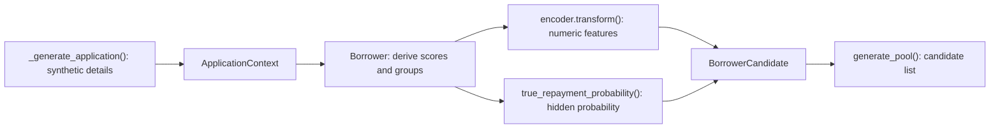
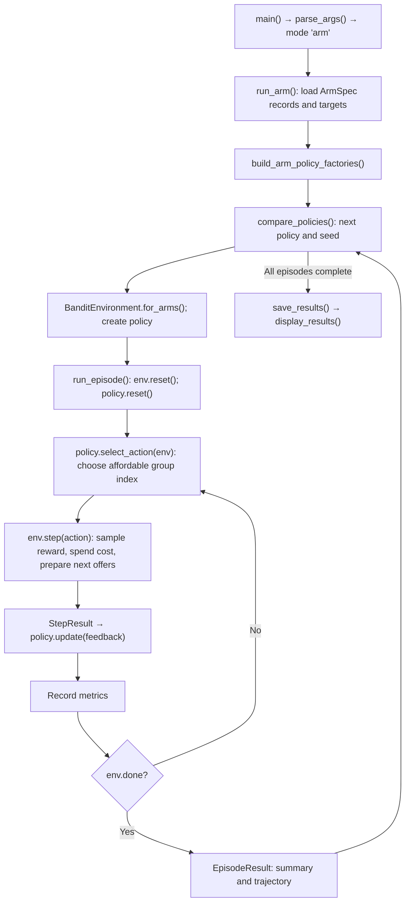
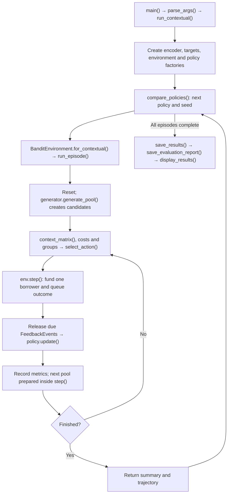
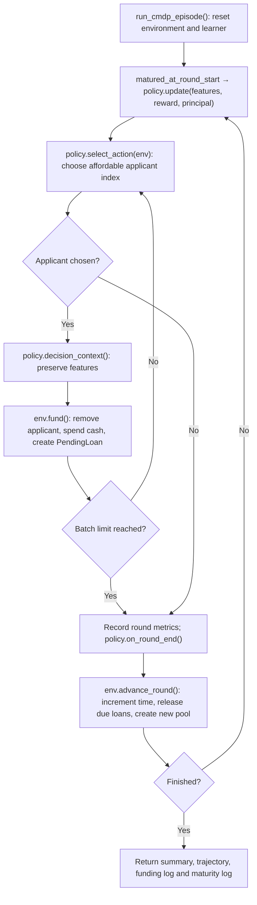
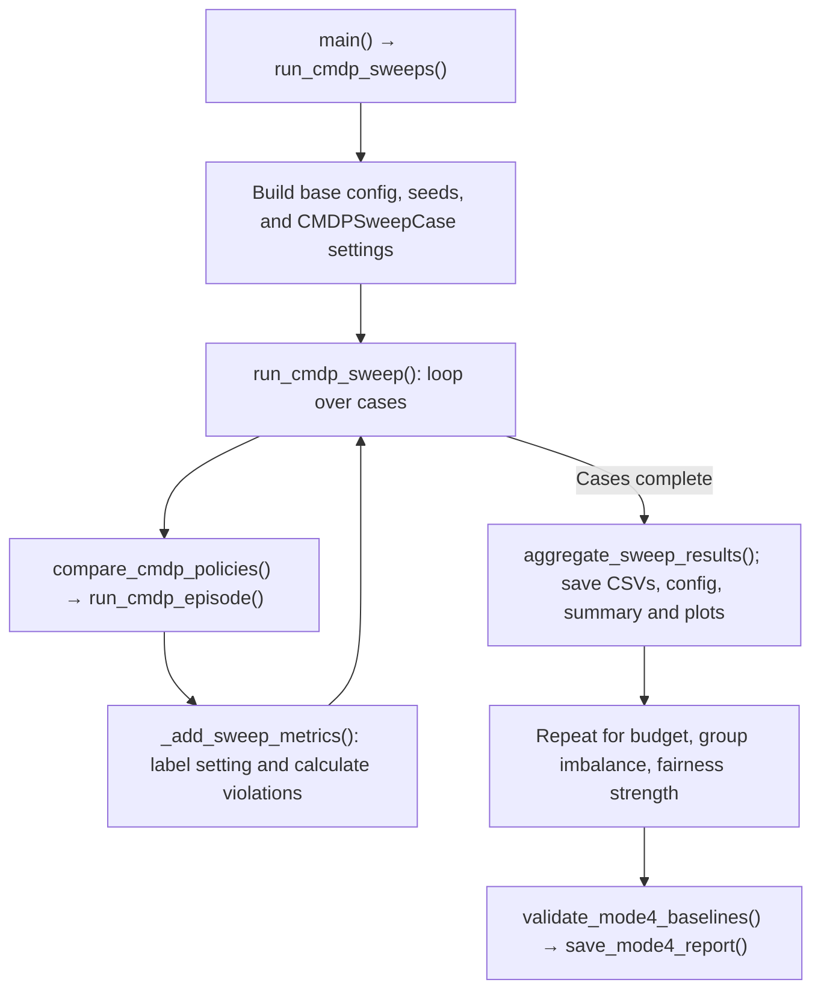
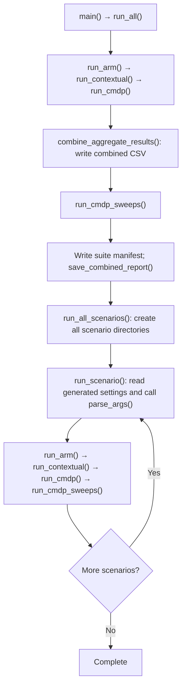

# Fair Budgeted Microfinance

This project simulates a lender deciding which loans to fund with limited money. It compares strategies that learn from repayments, account for loan costs, and try to give different borrower groups access to funding.

Choose a phase, and follow its command through the functions to the saved results. All numerical examples come from the existing `outputs/` files; the experiments were not rerun to write this readme.

## Contents

- [Fair Budgeted Microfinance](#fair-budgeted-microfinance)
  - [Contents](#contents)
  - [The basic idea](#the-basic-idea)
  - [Choose a mode and understand the command](#choose-a-mode-and-understand-the-command)
  - [Project structure and models](#project-structure-and-models)
    - [“Model” has two meanings](#model-has-two-meanings)
    - [How an application becomes numbers](#how-an-application-becomes-numbers)
  - [Phase 1: learn about borrower groups — Mode 1](#phase-1-learn-about-borrower-groups--mode-1)
    - [Function order and data flow](#function-order-and-data-flow)
    - [Algorithms in brief](#algorithms-in-brief)
    - [Read a saved example](#read-a-saved-example)
  - [Phase 2: learn from individual applications — Mode 2](#phase-2-learn-from-individual-applications--mode-2)
    - [Function order and data flow](#function-order-and-data-flow-1)
    - [Algorithms in brief](#algorithms-in-brief-1)
    - [Read a saved example](#read-a-saved-example-1)
  - [Phase 3: manage an ongoing loan portfolio — Mode 3](#phase-3-manage-an-ongoing-loan-portfolio--mode-3)
    - [Follow this command from start to finish](#follow-this-command-from-start-to-finish)
    - [The round loop](#the-round-loop)
    - [Algorithms in brief](#algorithms-in-brief-2)
    - [Follow three saved loans through maturity](#follow-three-saved-loans-through-maturity)
    - [Read the saved comparison](#read-the-saved-comparison)
  - [Mode 4: test changing conditions](#mode-4-test-changing-conditions)
  - [Mode 5: run the complete suite and scenarios](#mode-5-run-the-complete-suite-and-scenarios)
  - [What fairness means](#what-fairness-means)
  - [Read the results](#read-the-results)
    - [Which file should I open?](#which-file-should-i-open)
    - [Common columns](#common-columns)
    - [Additional Phase 3 columns](#additional-phase-3-columns)
    - [Ranking and sweep diagnostics](#ranking-and-sweep-diagnostics)
  - [Command options](#command-options)

## The basic idea

Imagine having enough money to fund only some of the applications on your desk. You want many loans to be repaid, but initially you do not know which choices work best. Funding a loan gives you experience that can improve the next decision.

| Term | Plain-language meaning here |
| --- | --- |
| Multi-armed bandit | A repeated decision problem: choose an option, see its outcome, and learn. You normally see outcomes only for the options you chose. |
| Arm / action | An available choice. In Phase 1 it is a borrower group; in Phases 2–3 it is an applicant in the current pool. |
| Policy / algorithm | The rule that chooses whom to fund. |
| Reward | **1 for a successful repayment, 0 for a default.** Total reward counts successful loans, not money or profit. |
| Cost / principal | The amount lent. A larger repaid loan still earns just one reward. |
| Exploration | Try something less familiar to learn about it. |
| Exploitation | Choose what currently looks best from experience. |
| Context / features | Application details converted into numbers the learner can use. |
| Environment | The simulated world: applicants, outcomes, money, time, and affordability. |
| Round | One decision in Phases 1–2; one time period with up to several loans in Phase 3. |
| Episode | One policy's complete experiment with one random seed. |
| Seed | A number that makes random draws reproducible under the same code, configuration, and software environment. |
| Horizon | The maximum number of rounds. It is a simulation time limit, not necessarily a number of days. |
| Informed benchmark | A comparison policy allowed to use repayment probabilities hidden from ordinary learners. |

Each episode starts with a fresh budget and fresh learning state. Ten seeds mean ten separate trials, not ten stages of one trained model. Policies can consume random draws differently, so using the same seed does not guarantee identical applicant sequences across policies.

The data is synthetic. Phase 1 uses configured group distributions; Phases 2–3 generate applications. There is no real borrower dataset to download. These experiments compare strategies under the simulator's assumptions.

## Choose a mode and understand the command

**Phase 1 is Mode 1. Mode 3 runs Phase 3**, the portfolio experiment. Modes 4 and 5 are experiment runners, not additional learning phases.

| Mode | Equivalent name | What it tests | Default money | Default destination |
| --- | --- | --- | ---: | --- |
| 1 | `arm` | Which borrower group should receive the next loan? | 600 | `outputs/arm/` |
| 2 | `contextual` | Which individual applicant should receive the next loan? | 600,000 | `outputs/contextual/` |
| 3 | `cmdp` | Whom should we fund while money is tied up in outstanding loans? | 600,000 | `outputs/cmdp/` |
| 4 | `sweeps` or `robustness` | How do Phase 3 results change with capital, population, or fairness settings? | Base capital 600,000 | `outputs/cmdp_robustness/` |
| 5 | `all` | Modes 1–4, followed by ten generated scenarios, each running Modes 1–4 | Phase-specific | `outputs/` and `outputs/all_scenarios/` |

To read existing results, open [the combined report](outputs/report.html), [Phase 2 report](outputs/contextual/report.html), [Phase 3 report](outputs/cmdp/report.html), or [sweep report](outputs/cmdp_robustness/report.html) in a browser. No installation or experiment run is needed for this.

To run experiments yourself, open a terminal in this repository. Use Python 3.10 or newer; the saved main-run manifests record Python 3.13.5. An isolated environment keeps the project's packages together:

```bash
python -m venv .venv
```

Activate it on macOS/Linux with `source .venv/bin/activate`, or in Windows PowerShell with `.venv\Scripts\Activate.ps1`. Then install the packages:

```bash
python -m pip install -r requirements.txt
```

If your system uses `python3`, substitute that for `python`. NumPy handles numerical arrays, pandas handles result tables, Matplotlib draws plots, and pytest is for development tests.

For a small first experiment that saves separately from the supplied outputs:

```bash
python main.py --mode 1 --seeds 1 --rounds 10 --output outputs/my_first_run
```

Read this from left to right: `python` starts Python; `main.py` is the entry file; `--mode 1` chooses the group experiment; `--seeds 1` runs every policy once; `--rounds 10` allows at most ten decisions per episode; `--output` chooses the destination. A **flag** is an option beginning with `--`; its following value supplies the setting. This command still compares all 13 Phase 1 policies.

The ordinary phase commands are:

```bash
python main.py --mode 1
python main.py --mode 2
python main.py --mode 3
```

These are alternatives: run the one you want. Without `--mode`, `python main.py` opens a menu. Runs write into their destination again, so choose a new `--output` path to retain earlier results. Mode 5 is a large batch; even `--quick-test` does **not** shrink its ten scenario runs.

## Project structure and models

| File or folder | Responsibility | Start here if you want to understand… |
| --- | --- | --- |
| [main.py](main.py) | Reads command options, builds configurations and policies, dispatches experiments. | Which functions your command calls. |
| [evaluate.py](evaluate.py) | Runs episodes, collects rows, computes averages, ranks policies, saves reports. | The decision loop and results. |
| [Algorithms/](Algorithms/) | Policy selection and learning rules. | Why a borrower was chosen. |
| [Environments/base_environment.py](Environments/base_environment.py) | Shared `BanditEnvironment` for Phases 1–2. | Spending a one-use budget and returning feedback. |
| [Environments/cmdp_environment.py](Environments/cmdp_environment.py) | `StatefulMicrofinanceCMDPEnv` for Phase 3. | Pending loans, maturity, and recycled cash. |
| [simulation.py](simulation.py) | `SyntheticBorrowerGenerator` creates applicants and hidden repayment probabilities. | Where individual borrower data comes from. |
| [Data/](Data/) | Default arms, borrower-derived information, and feature encoding. | How raw data becomes algorithm input. |
| [models/](models/) | Structured records and validated settings. | What information functions pass between them. |
| [metrics.py](metrics.py) | Definitions of utility, capital, and fairness measurements. | What a result column means. |
| [robustness.py](robustness.py) | Runs and reports sensitivity sweeps. | Mode 4. |
| [outputs/](outputs/) | Saved CSV tables, JSON settings, HTML reports, and PNG plots. | Examples of completed experiments. |
| [tests/](tests/) | Development checks. | Expected behavior; run with `python -m pytest -q`. |

### “Model” has two meanings

A **data model** is a structured container, like a form with named fields. It does not learn. A **prediction model** learns a relationship between features and repayments. The former lives mostly in `models/`; the shared learned `LinearRidgeModel` lives in [Algorithms/contextual.py](Algorithms/contextual.py).

| Model / record | What it contains or does |
| --- | --- |
| `ArmSpec` | A group's label, true repayment probability, and loan-cost mean and standard deviation. |
| `ApplicationContext` | The original application: income, requested amount, debt, repayment history, age, sector, and other details. |
| `Borrower` in `Data/borrower.py` | Wraps the application and derives group membership, poverty-relief score, and vulnerability score. |
| `BorrowerCandidate` | Bundles a borrower, its numeric feature vector, and a hidden repayment probability for simulation. |
| `EnvironmentConfig`, `ContextualEnvironmentConfig`, `CMDPEnvironmentConfig` | Budget/capital, horizon, seeds, and phase-specific pool, delay, and population settings. |
| `FairnessConfig`, `LagrangianConfig` | Quota/parity settings and, for Lagrangian fairness, adaptive penalty controls. |
| `AlgorithmConfig`, `ExperimentConfig` | Containers for learning parameters and experiment/output settings. The runner also sets parameters directly; consult `main.py` and saved manifests for the actual run values. |
| `FeedbackEvent` | A chosen arm or borrower, reward, cost, and due round; includes features for contextual learning. |
| `StepResult` | A completed Phase 1/2 decision, budget and fairness snapshots, and feedback available now. |
| `PendingLoan` | An outstanding Phase 3 loan, due round, hidden outcome, and original learning features. |
| `FundingResult` | The loan just issued and the resulting capital state. |
| `MaturedLoanFeedback` | An outcome now revealed to the learner, its original features, and returned cash. |
| `RoundAdvanceResult` | The new round, matured feedback, capital balances, and stop flag. |
| `EpisodeResult`, `CMDPEpisodeResult` in `evaluate.py` | Episode summary and trajectory tables; the CMDP version also carries funding and maturity logs. |

A **factory** is a function that constructs a fresh object when called. The comparison runner calls environment and policy factories for every seed so experiments do not share learned history.

### How an application becomes numbers

Phases 2–3 share this data preparation:



The default encoder produces 28 features: 13 numerical/Boolean entries, five sector indicators, six purpose indicators, and four region-type indicators. An indicator is 1 when a category applies and 0 otherwise. Twenty applicants therefore form a **20 × 28 matrix**: applicants are rows, features are columns.

The generator uses a logistic formula to create hidden repayment probabilities between 0.05 and 0.95. The learner estimates rewards from observed funded loans. Its ridge model maintains feature weights: observations adjust those weights to better fit repayment outcomes. Regularization stabilizes estimates when little data is available. A default also teaches the model something.

For readers following the mathematics, the ridge update is `A ← A + x xᵀ`, `b ← b + r x`, with weights `θ = solve(A, b)`. Here `x` is one borrower's feature vector and `r` is 0 or 1. The prediction is `xᵀθ`. These linear estimates and exploration scores are not automatically probabilities in the range 0–1.

The default encoder omits the optional direct protected-group indicators, but still includes age and derived poverty/vulnerability scores that depend partly on protected characteristics. `protected_attributes_in_prediction: false` does not mean all such information has been removed.

## Phase 1: learn about borrower groups — Mode 1

**Purpose:** compare learning rules when the choices are three repeatable borrower groups. There are no individual application features in this phase.

```bash
python main.py --mode 1
```

With defaults, each policy gets 600 budget units, at most 150 decisions, and seeds 0–9. Thirteen policies × ten seeds gives **130 episodes**.

The defaults in [Data/arm_data.py](Data/arm_data.py) are:

| Action index | Group | True repayment chance | Mean cost | Cost standard deviation | Minimum share of loans |
| --- | --- | ---: | ---: | ---: | ---: |
| 0 | A | 80% | 12 | 1.2 | 20% |
| 1 | B | 65% | 8 | 0.8 | 30% |
| 2 | C | 50% | 4 | 0.4 | 30% |

Before a decision, each group gets a new cost sampled around its mean, clipped to at least 0.01. Standard deviation describes the spread of costs, so A does not always cost 12. Policies see today's costs; ordinary learners do not use the true repayment chances.

### Function order and data flow



Read the loop as follows: `select_action()` asks which offers are affordable, scores them, and returns an integer such as `2`. `step(2)` funds Group C, draws a success/default, subtracts the cost, updates allocation counts, and returns feedback. `update()` lets the policy learn from that feedback. The evaluator records the round and repeats until the horizon or no current affordable offer remains.

In [Algorithms/bandit.py](Algorithms/bandit.py), `ArmPolicy` tracks trial counts, reward sums, and cost sums per group. Seven repayments from ten funded loans give an estimated repayment chance of `7 / 10 = 0.7`. That estimate is learned; it is distinct from the simulator's configured probability. Repayments **do not replenish the budget** in this phase.

### Algorithms in brief

| Saved policy name | Rule and purpose |
| --- | --- |
| `random` | Pick an affordable group randomly; a baseline without learning-based selection. |
| `epsilon_greedy` | Try untested groups, then choose the highest observed repayment rate most of the time; explore randomly with probability 0.10. |
| `decaying_epsilon_greedy` | Reduce random exploration as experience grows, keeping a minimum of 0.05. |
| `ucb` | Upper Confidence Bound: estimated repayment rate plus an uncertainty bonus, encouraging less-tested groups. |
| `thompson` | Maintain a Beta distribution for each group's repayment chance; sample plausible chances and choose the highest. Success/failure updates the distribution. |
| `epsilon_first` | Use roughly the first 20% of budget for exploration, then choose by estimated repayment per current cost. |
| `reward_per_cost` | Try untested groups, then prefer estimated repayments per budget unit. |
| `budgeted_ucb` | Divide UCB's optimistic reward score by current cost to combine learning and efficiency. |
| `fractional_kube` | Uses the same score as Budgeted UCB in this implementation. |
| `kube` | KUBE-style adaptation that computes a mix using rounded costs and samples a group in proportion to that mix. Replan after funding one loan. |
| `fair_ucb_hard` | Apply quota/parity selection restrictions around Budgeted UCB. |
| `fair_ucb_soft` | Add `2 × quota shortfall` to Budgeted UCB scores to encourage underserved groups. |
| `true_reward_per_cost` | Informed greedy true reward-per-cost benchmark. |

All policies obey affordability. Cost-aware policies additionally use cost to decide *which* affordable option to prefer. UCB's bonus is `sqrt(2 × ln(max(2, t + 1)) / n)`, where `n` is that group's observed count and `t` is the total number of updates. Untested groups receive infinite scores to encourage initial exploration.

### Read a saved example

In [the episode summaries](outputs/arm/episode_summaries.csv), `budgeted_ucb`, seed 0, funded 135 loans, obtained 71 successful repayments, and spent 597.7302:

```text
Repayment rate     = 71 / 135       = 52.59%
Reward per cost    = 71 / 597.7302  = 0.11878 successes per budget unit
Budget utilization = 597.7302 / 600 = 99.62%
Remaining budget  = 600 − 597.7302  = 2.2698
```

It funded A/B/C respectively 5/12/118 times. Only C met its target, so quota satisfaction was `1 / 3 = 33.33%`. Its parity gap was 0.83648; the [fairness section](#what-fairness-means) explains this different denominator.

Across ten seeds, [the aggregate results](outputs/arm/aggregate_results.csv) show:

| Policy | Mean successful repayments | Repayment rate | Reward per cost | Quota satisfaction |
| --- | ---: | ---: | ---: | ---: |
| `true_reward_per_cost` | 75.0 | 50.07% | 0.1261 | 33.33% |
| `budgeted_ucb` / `fractional_kube` | 70.8 each | 55.71% | 0.1183 | 33.33% |
| `fair_ucb_hard` | 54.5 | 62.23% | 0.0911 | 93.33% |
| `epsilon_greedy` | 41.0 | 70.62% | 0.0685 | 33.33% |

Why can a lower repayment percentage produce more repayments? Using mean costs, C offers `0.50 / 4 = 0.125` expected successes per unit, whereas A offers `0.80 / 12 ≈ 0.0667`. Cheaper loans permit more trials. The identical Budgeted UCB/Fractional KUBE results reflect their matching scoring rules. The informed greedy benchmark ranks the offers available at each decision.

The saved tables are from the original runs. Correcting forced initial exploration can change the epsilon-greedy and decaying epsilon-greedy trajectories.

## Phase 2: learn from individual applications — Mode 2

**Purpose:** use observable borrower characteristics to choose among new applicants, while still spending a budget that is not replenished.

```bash
python main.py --mode 2
```

Defaults: 600,000 budget units, 150 rounds, 20 fresh applicants per round, immediate feedback, and ten seeds. Fourteen policies × ten seeds gives **140 episodes**. Each round funds one affordable applicant; the remaining applicants are discarded when the next pool arrives.

### Function order and data flow



`run_contextual()` builds settings and the encoder. The environment converts its candidate list into feature rows, costs, and audit groups. The policy scores those rows and returns the chosen pool index. `step()` samples repayment, spends the requested amount, and stores the chosen features in a `FeedbackEvent`. The evaluator passes released feedback to `update()`, which adjusts the shared ridge model.

With `--feedback-delay 3`, a loan funded at round 0 becomes eligible for feedback release during the step at round 3. Selection in that round occurs before the step releases feedback. The exported reward is known to the evaluator from funding time, while the learner must wait. An episode can end with `pending_feedback`; it does not keep lending or advance extra rounds just to train on those outcomes. It stops at the horizon or when the current pool has no affordable applicant.

### Algorithms in brief

All three learning families use the same type of ridge learner. Their exploration rules differ:

| Family | How it chooses |
| --- | --- |
| Contextual epsilon-greedy | Usually choose the highest predicted reward; about 10% of score calls explore randomly. |
| LinUCB | Choose predicted reward plus an uncertainty bonus based on how well the features have been observed. The runner uses bonus coefficient `alpha = 0.70`. |
| Contextual Thompson sampling | Sample plausible feature weights, then choose using their predicted rewards. The runner uses sampling scale `0.30`. |

The 14 saved policies comprise a random baseline, the informed greedy true reward-per-cost benchmark (`true_contextual_reward_per_cost`), three ordinary learning policies, three `budgeted_...` policies, and six fairness variants. Budgeted variants divide reward scores by loan cost. `fair_epsilon_greedy_hard/soft`, `fair_linucb_hard/soft`, and `fair_thompson_hard/soft` wrap the budgeted learners. Hard wrappers restrict choices for fairness and soft wrappers add a quota-shortfall bonus with coefficient 0.015. The ordinary names are `contextual_epsilon_greedy`, `linucb`, and `contextual_thompson`.

### Read a saved example

In [the episode summaries](outputs/contextual/episode_summaries.csv), `fair_linucb_hard`, seed 0:

- Funded 150 loans and obtained 113 repayments: `113 / 150 = 75.33%`.
- Spent 436,512.60 of 600,000: utilization was **72.75%**. The 150-round limit explains why money remained.
- Produced `113 / 436,512.60 × 10,000 ≈ 2.589` successful repayments per 10,000 units lent.
- Met all four quotas, but had a parity gap of **2.265 percentage points**.

[The ranked comparison](outputs/contextual/ranked_results.csv) averages ten seeds:

| Rank | Policy | Successful repayments | Repayment rate | Parity gap (percentage points) | All mean fairness thresholds met? |
| --- | --- | ---: | ---: | ---: | --- |
| 1 | `fair_linucb_hard` | 112.1 | 74.73% | 1.202 | No |
| 2 | `fair_thompson_hard` | 111.1 | 75.43% | 1.268 | No |
| 3 | `fair_epsilon_greedy_hard` | 108.2 | 75.46% | 1.319 | No |

All three have mean quota satisfaction 1.0. **No policy in this saved Phase 2 comparison meets both mean fairness thresholds.** First place is the smallest-violation compromise: its mean parity gap 0.01202 exceeds the configured 0.010 threshold. A first-place label alone does not establish fairness feasibility.

## Phase 3: manage an ongoing loan portfolio — Mode 3

**Purpose:** account for time and outstanding loans. Lending reduces cash now; repayments later return some cash for reuse. Defaults reduce capital.

A **Constrained Markov Decision Process (CMDP)** describes lending decisions with persistent capital, a current applicant pool, outstanding loan records and maturity times, and fairness counts. The policies use heuristic scores based on observable information. The [mathematical formulation](MATHEMATICAL_FORMULATION.md#phase-3-cmdp) gives the event order, capital transition, and constraints.

### Follow this command from start to finish

```bash
python main.py --mode 3
```

This is equivalent to explicitly supplying these defaults:

```bash
python main.py --mode 3 --budget 600000 --rounds 150 --seeds 10 --pool-size 20 --batch-size 3 --repayment-delay 8 --recycle-fraction 1.0 --default-recovery 0.0 --liquidity-reserve 0 --parity-tolerance 0.05 --output outputs/cmdp
```

Each policy starts with 600,000 cash units. Each round offers 20 applicants and allows up to three loans. Loans mature eight rounds after funding. A repaid loan returns its full principal; a default returns nothing under these defaults. There is no interest income. Twelve policies × ten seeds gives **120 episodes**, each permitting up to `150 × 3 = 450` loans.

1. Python loads imports and definitions. At the bottom of `main.py`, `if __name__ == "__main__": main()` starts execution. Importing an algorithm defines it; it does not run its experiment.
2. `main()` calls `parse_args()`, which reads and validates the flags. `MODE_ALIASES` translates `"3"` to `"cmdp"`.
3. `run_cmdp(args)` builds a `CMDPEnvironmentConfig`, a `BorrowerFeatureEncoder`, seeds 0–9, and the factories from `build_cmdp_policy_factories()`.
4. `compare_cmdp_policies()` loops over policies, and within each policy over seeds. It creates a fresh `StatefulMicrofinanceCMDPEnv` and policy, then calls `run_cmdp_episode()`.
5. `run_cmdp_episode()` resets both objects and performs the round loop below. It returns summary, trajectory, funding-log, and maturity-log tables.
6. `save_cmdp_results()` saves the combined tables and plots. `save_evaluation_report()` ranks aggregate results and writes the report, settings manifest, and winner summary. `display_results()` prints the comparison and destination.

### The round loop



The loan's data takes this route:

```text
BorrowerCandidate → select_action() returns its current pool index
                  → decision_context() preserves the feature vector
                  → fund() creates PendingLoan with principal and due round
                  → advance_round() releases the loan when due
                  → MaturedLoanFeedback carries the original vector and outcome
                  → policy.update() teaches the learner from that loan
```

`fund()` samples the outcome immediately for simulation, but the learner sees it only at maturity. Saved `hidden_reward` and `true_repayment_probability` fields are evaluator information. The chosen applicant is removed from the pool. The next selection uses updated cash, applicants, and fairness counts, so a batch is selected **one loan at a time**.

At round end, Lagrangian policies update their fairness penalty weights. Advancing the round releases due loans into cash and prepares a fresh pool; unfunded applicants are not carried forward. The policies generally keep funding affordable applicants even if the best score is negative; there is no explicit score-based “hold cash” action. The environment can wait through empty lending rounds while repayments are pending. It stops at the horizon, or earlier when no loans are pending and spendable cash is below the minimum loan cost.

### Algorithms in brief

| Saved policy / family | Rule and purpose |
| --- | --- |
| `random_cmdp` | Choose affordable applicants randomly; baseline. |
| `context_only_budgeted_linucb` | Optimistic borrower reward divided by normalized cost; compare against portfolio-aware scoring. |
| `portfolio_epsilon_greedy` | Sometimes explore randomly; otherwise prefer predicted reward minus a capital-use penalty. |
| `portfolio_linucb` | Predicted reward plus uncertainty bonus minus a capital-use penalty. |
| `portfolio_thompson` | Sample plausible prediction weights, then subtract a capital-use penalty. |
| `cmdp_fair_hard_...` | Wrap epsilon-greedy, LinUCB, or Thompson with quota/parity selection restrictions: three policies. |
| `cmdp_fair_lagrangian_...` | Wrap the same three families with adaptive penalties for projected fairness violations: three policies. |
| `oracle_portfolio` | Informed Portfolio-Aware Heuristic. It subtracts a liquidity-dependent capital-use penalty from the true repayment probability. |

For portfolio LinUCB, the score is approximately:

```text
predicted reward + uncertainty bonus
− shadow price × (requested loan / median loan in the current pool)
```

A **shadow price** is the heuristic score penalty per unit of normalized loan cost. For portfolio LinUCB and epsilon-greedy, it increases with liquidity pressure and default losses, while principal due soon provides relief. Portfolio Thompson sampling and the Informed Portfolio-Aware Heuristic use a simpler liquidity-dependent penalty. The ridge model uses the borrower's 28 features.

The Lagrangian wrapper normalizes base scores and subtracts penalties for projected quota deficits and parity excess. Its `lambda_quota` and `lambda_parity` weights adapt after a five-round warmup, starting at 0.20 with learning rate 0.20 and a cap of 8. Larger weights make fairness violations more costly to the selection rule.

### Follow three saved loans through maturity

Filter [funding_log.csv](outputs/cmdp/funding_log.csv) to `policy = cmdp_fair_hard_linucb`, `seed = 0`, `round = 0`:

| Applicant | Audit group | Principal | Eventual outcome | Due round |
| --- | --- | ---: | --- | ---: |
| `APP-0000008` | women | 5,260.26 | Repaid | 8 |
| `APP-0000002` | minority | 5,259.91 | Defaulted | 8 |
| `APP-0000006` | reserved | 11,106.21 | Repaid | 8 |

At the end of round 0, cash is `600,000 − 21,626.38 = 578,373.62`, capital at risk is 21,626.38, and all three outcomes are pending for learning. At round 8, [maturity_log.csv](outputs/cmdp/maturity_log.csv) records returned cash of `5,260.26 + 0 + 11,106.21 = 16,366.47`. The learner receives success, default, success with the original features. Other loans issued in between also affect the round-8 cash balance.

### Read the saved comparison

From [ranked_results.csv](outputs/cmdp/ranked_results.csv), averaged over ten seeds:

| Rank | Policy | Successful repayments | Repayment rate | Successes per 10,000 lent | Parity gap (percentage points) | Fairness feasible? |
| --- | --- | ---: | ---: | ---: | ---: | --- |
| 1 | `cmdp_fair_hard_linucb` | 349.9 | 77.76% | 1.911 | 4.07 | Yes |
| 2 | `cmdp_fair_hard_epsilon_greedy` | 350.2 | 77.86% | 1.821 | 3.34 | Yes |
| 3 | `cmdp_fair_hard_thompson` | 343.7 | 77.01% | 1.798 | 4.16 | Yes |
| 5 | `oracle_portfolio` | 370.9 | 82.42% | 2.687 | 6.92 | No |

The first policy ranks highest because it meets the mean fairness thresholds and has the best reward per cost among policies that meet them. The Informed Portfolio-Aware Heuristic has more repayments and exceeds the mean parity threshold.

For `cmdp_fair_hard_linucb`, seed 0, [the episode summary](outputs/cmdp/episode_summaries.csv) gives a concrete capital example:

```text
Loans funded                         450
Eventual successful repayments       359
Repayments observed by the horizon   346
Principal disbursed                   1,821,191.78
Final available cash                  213,780.85
Final outstanding principal           65,664.47
Eventual terminal capital             251,314.99
```

Turnover is `1,821,191.78 / 600,000 = 3.0353`: returned cash has been lent again. Capital survival is `(213,780.85 + 65,664.47) / 600,000 = 46.57%`, counting outstanding principal at face value. Eventual terminal capital instead uses the hidden future returns of pending loans. The 13 additional eventual successes (`359 − 346`) have not yet been observed at the horizon.

## Mode 4: test changing conditions

**Purpose:** repeat Phase 3 under different settings to see how sensitive the conclusions are. A **sweep** changes one kind of setting across a list of values.

```bash
python main.py --mode 4
```

| Sweep | Full default values | Policies at each value | Episodes with ten seeds |
| --- | --- | --- | ---: |
| Budget | Initial-capital multipliers 0.50, 0.75, 1.00, 1.25, 1.50 | All 12 CMDP policies | 600 |
| Group imbalance | Marginalized-community probabilities 0.10, 0.20, 0.30, 0.40, 0.50 | All 12 CMDP policies | 600 |
| Fairness strength | 0.00, 0.25, 0.50, 0.75, 1.00, 1.25 | Three hard and three Lagrangian policies | 360 |

The full default sweep contains **1,560 episodes**. Strength has different meanings: for hard policies it scales quota targets while keeping parity tolerance fixed; for Lagrangian policies it scales applied penalties while keeping targets and dual updates fixed. Strength zero therefore does not switch off every hard fairness rule. The marginalized probability controls a generated attribute, not the final primary `minority` audit share, because audit labels have a priority order.



There is no new learner here: each case reuses the Phase 3 loop. Extra fields such as `sweep_value`, `parameter_kind`, and `is_baseline` say which setting generated a row. Baseline validation checks shared reference settings across the sweeps for consistency.

The supplied [budget summary](outputs/cmdp_robustness/sweeps/budget/summary.json) records 183 of 600 episodes satisfying both final fairness thresholds; the [group-imbalance summary](outputs/cmdp_robustness/sweeps/group_imbalance/summary.json) records 125 of 600; the [fairness-strength summary](outputs/cmdp_robustness/sweeps/fairness_strength/summary.json) records 189 of 360. These are counts across the policies, settings, and seeds in each sweep, not success rates for an individual algorithm. All three hard-policy families maintained mean quota satisfaction 1.0 at all five budget settings, but that alone does not establish parity compliance.

For a smaller standalone sweep:

```bash
python main.py --mode 4 --quick-test --rounds 3 --output outputs/my_small_sweep
```

This uses at most two seeds and two values per sweep. Three rounds are shorter than the default eight-round repayment delay, so it is useful for checking the workflow, not drawing conclusions about learning from repayments.

## Mode 5: run the complete suite and scenarios

```bash
python main.py --mode 5
```

**This executes Modes 1–4, then ten scenario runs that each execute Modes 1–4.** It does not just collect existing files.



`generate_scenarios()` prepares ten repeatable configurations using master seed 5726455. Scenarios vary budgets, horizons, populations of applicants per round, delays, lending limits, and capital-return settings. Each gets its own seed range and a separate Phase 1 budget. `run_scenario()` converts its settings into command arguments and passes them through the same parser used by individual runs.

The main suite writes `arm/`, `contextual/`, `cmdp/`, and `cmdp_robustness/` beneath `outputs/` or your `--output` root. It writes [report.html](outputs/report.html), [combined_aggregate_results.csv](outputs/combined_aggregate_results.csv), and [run_manifest.json](outputs/run_manifest.json) at that root. The supplied combined CSV contains **39 policy rows: 13 + 14 + 12** from Modes 1–3. Sweep results remain in their sweep folders; phases are not ranked against one another.

Scenario results go to `all_scenarios/scenario_1/`, and so on, beneath the same root. Each scenario contains the four mode folders. Directories are created before execution, so an existing folder alone is not evidence of a completed run. The runner starts from the beginning and has no resume logic.

`--quick-test --rounds 3 --seeds 2` reduces the main suite, including its sweeps, but **the ten scenarios still use their own full settings**. For a small first test, use the standalone Mode 1 or Mode 4 command above.

## What fairness means

Fairness is measured through two different questions: **who receives the funded loans**, and **how often available applicants from each group get funded**.

| Measurement | Formula | Example |
| --- | --- | --- |
| Allocation share | Group's funded loans ÷ all funded loans | 137 of 450 loans gives 30.44%. |
| Funding rate | Group's funded loans ÷ group's affordable opportunities | 137 of 951 opportunities gives 14.41%. |
| Demographic parity gap | Highest group funding rate − lowest group funding rate | 0.04 means a four-percentage-point gap; smaller is better for parity. |
| Quota deficit | `max(0, target share − actual allocation share)` | Target 25%, actual 20% gives a deficit of 0.05. |
| Total quota deficit | Sum of positive group deficits | Overfunding one group does not cancel another group's shortage. |
| Quota satisfaction rate | Target groups meeting their minimum share ÷ number of target groups | Three of four gives 0.75. |

Phase 1 targets are A 20%, B 30%, C 30%. Phases 2–3 target `disabled` 4%, `reserved` 8%, `minority` 12%, and `women` 25%. These are minimum shares of **loan counts**, not money. The unassigned share remains flexible.

Each individual borrower is counted in one primary audit group, with priority `disabled → reserved → minority → women → aged → none`. A woman with a disability is counted under `disabled`; `funded_women` therefore does not count every female borrower. `aged` and `none` participate in group comparisons but have no default quota.

An opportunity in Phase 1 is an affordable offer for a group at a decision; in Phases 2–3 it is an affordable applicant counted when the pool arrives. Near budget exhaustion, different groups may have different opportunity counts. For Phase 1's Budgeted UCB seed-0 example, parity is `118/135 − 5/133 = 0.83648`, comparing C's and A's funding rates rather than their allocation shares.

**Hard fairness** first intervenes for quota shortages and can then prioritize low funding rates when parity is outside tolerance. “Hard” refers to restrictions on selection; it does not guarantee all final quotas and parity thresholds in every episode. **Soft fairness** adds a fixed quota bonus in Phases 1–2. **Lagrangian fairness** in Phase 3 adapts penalty weights for projected violations.

The Phase 1 hard wrapper uses parity tolerance **0.35**, Phase 2 uses **0.010**, and Phase 3 defaults to **0.05**. The command-line `--parity-tolerance` controls Phase 3 and its sweeps, not the Phase 1/2 constants.

## Read the results

### Which file should I open?

| File | What one row or artifact represents |
| --- | --- |
| `episode_summaries.csv` | One policy with one seed, after its complete episode; Modes 1–3. |
| `trajectories.csv` | One decision round for one policy and seed; follow change over time. Round indices begin at 0. |
| `aggregate_results.csv` | Means and standard deviations across seeds for each policy; sweep aggregates also separate settings. |
| `ranked_results.csv` | Flattened aggregates, fairness checks, and rank; Modes 2–3. |
| `funding_log.csv` | One issued loan, including its hidden evaluator outcome; Mode 3 and sweeps. |
| `maturity_log.csv` | One matured loan and the cash it returned; Mode 3 and sweeps. |
| `run_manifest.json` | Saved configuration, policies, and other run metadata. Phase manifests include software versions. Standalone Mode 1 does not write one. |
| `report.html`, `winner_summary.txt` | Readable comparison; winner summary is written for Modes 2–3. Standalone Mode 1 uses the printed table, CSVs, and plots. |
| `*.png` | Plots of metric means over rounds; sweep plots compare parameter values. Check the axis and metric name before comparing. |
| Sweep `raw_results.csv` | One episode plus its sweep settings and diagnostic metrics; this is the sweep summary table. |
| Sweep `config.json`, `summary.json` | Exact sweep configuration and summarized findings/counts. |
| Reports `report.html` | Exact sweep configuration and summarized findings/counts and the tables in viewable manner present for each mode. |

Each Mode 4 sweep has its own directory beneath `outputs/cmdp_robustness/sweeps/`. Rerunning a sweep removes its legacy duplicate `episode_summaries.csv`; current sweep summaries are in `raw_results.csv`.

Main phase aggregate CSVs use multiple header rows to group `mean` and `std` under metric names. In pandas, read them with `pd.read_csv(path, header=[0, 1], index_col=0)`. Ranked CSVs have ordinary flat names such as `cumulative_reward_mean` and can be read with a normal single-header CSV reader.

### Common columns

| Column | Meaning |
| --- | --- |
| `policy`, `seed` | Strategy name and trial identifier. Use both when filtering an episode. |
| `rounds` | Loans funded in Phases 1–2; elapsed rounds in Phase 3. |
| `loans_funded` | Number issued in Phase 3, which can exceed the number of rounds. |
| `cumulative_reward` | Total successful repayments. In Phase 3 it includes eventual outcomes of loans still pending at the horizon. Phase 2 also reports sampled outcomes even if feedback is delayed. |
| `cumulative_cost` / `cumulative_disbursed` | Sum of amounts lent; the latter is the Phase 3 name. Repeated lending of recycled cash contributes again. |
| `repayment_rate` | Successful repayments ÷ loans funded; 0.75 means 75%, not 0.75%. |
| `reward_per_cost` | Successful repayments ÷ total amount lent; multiply by 10,000 to express successes per 10,000 units. It is not a profit or repayment percentage. |
| `budget_utilization` | In Phases 1–2, spending ÷ starting budget. In sweep summaries, `(initial capital − final cash) / initial capital`; use turnover to measure repeated lending. |
| `pending_feedback` | Phase 2 outcomes still unavailable to the learner; Phase 1 has immediate feedback. |
| `funded_G`, `opportunities_G` | Loans and affordable opportunities for audit group G. |
| `allocation_share_G`, `funding_rate_G`, `quota_deficit_G` | Per-group versions of the fairness measures above, where exported. |

`mean` is the average of episode values. `std` is sample standard deviation across seeds, describing variation, not a confidence interval. A reported `349.9 ± 13.02` successful repayments is an average ± standard deviation; individual episodes have integer successes. For one seed the reporting code fills undefined aggregate standard deviation with zero. Ratios are calculated per episode and then averaged, so an average ratio need not equal a ratio of averages.

### Additional Phase 3 columns

| Column | Meaning |
| --- | --- |
| `observed_reward_by_horizon` | Repayments actually revealed by episode end. |
| `observed_repayments`, `observed_defaults` | Trajectory counts of matured successes/defaults. |
| `eventual_cumulative_reward` | Trajectory/sweep name for total sampled successful outcomes, including pending ones. |
| `available_capital` / `final_available_capital` | Spendable cash before applying any reserve requirement. |
| `capital_at_risk` / `final_capital_at_risk` | Principal still outstanding, before its actual return is realized. |
| `pending_loans` | Number of outstanding loans. |
| `cumulative_recycled` | Cash returned through maturity events by the current time or horizon. |
| `cumulative_default_loss` / `default_loss_by_horizon` | Principal lost on defaults already observed, net of configured recovery. |
| `capital_turnover` | Total disbursed ÷ initial capital. Above 1 means cash has funded more than one cycle of loans. |
| `capital_survival_ratio` | `(cash + outstanding principal) / initial capital`; values outstanding loans at face value. |
| `eventual_terminal_capital` | Final cash plus eventual recoverable returns from pending loans, using simulator knowledge. |
| `liquidity_utilization` | Outstanding principal ÷ (cash + outstanding principal). |
| `observed_repayment_rate` | Success rate among matured loans only. |
| `recent_repayment_rate` | Success rate among the latest 30 observed outcomes. Both observed-rate fields use 0.5 before any outcomes arrive. |
| `lambda_quota`, `lambda_parity` | Current Lagrangian penalty weights; episode summaries use `_final` suffixes. |
| `state_bucket` | Reporting label for cash, parity, recent repayment, and quota-deficit bands; not a learned value table. |

For example, `B1-F0-R2-Q0` means cash is 20%–55% of initial capital, parity is within tolerance, recent repayment rate is at least 75%, and total quota deficit is at most 0.01. The other cash cutoffs are 20%/55%; parity bands use tolerance/twice tolerance; repayment cutoffs are 55%/75%; quota cutoffs are 0.01/0.10.

Timing matters: the final Phase 3 trajectory row is recorded **before** the last `advance_round()`, while the episode summary includes maturities released by that advance. For hard-fair LinUCB seed 0, the final trajectory has 343 observed repayments and 24 pending loans; the summary has 346 and 21. This is why the last trajectory row need not match every summary field.

### Ranking and sweep diagnostics

For Modes 2–3, `rank_results()` first checks whether the **mean** parity gap is within the mode's tolerance and the **mean** total quota deficit is at most 0.01. It then orders policies by:

1. Fairness-feasible policies first.
2. Within feasible policies: higher reward per cost, then higher cumulative reward.
3. Within infeasible policies: smaller combined parity/quota excess, then reward efficiency and reward.

`parity_excess` and `quota_excess` are positive amounts beyond the thresholds; `fairness_violation` sums them. `fairness_feasible` indicates passing these aggregate checks. It does not mean every seed or every round passes. If nobody qualifies, the first-ranked policy is labelled the best compromise. Mode 1's aggregate table instead sorts by mean cumulative reward.

Sweep `constraint_satisfied` checks an individual episode's final thresholds. `constraint_violation` measures the final excess; `fairness_violations` counts recorded rounds outside thresholds. `sweep_value` is the tested value, interpreted using `parameter_kind`. Sweep `cumulative_immediate_reward` is an alias for reward **observed by the horizon**, despite its name; `eventual_cumulative_reward` includes pending outcomes. `recycled_capital` and `final_remaining_capital` alias returned cash and final available cash.

Sweep opportunity-feasibility diagnostics screen whether observed opportunity counts can support the constraints. A screened-feasible episode with violations is classified separately from an opportunity-count-infeasible episode. This is an opportunity-count screen, not proof that all constraints could have been achieved throughout the full cash-and-time trajectory.

Compare policies within the same phase and configuration. Phase 1 uses a different cost scale, Phase 2 has a one-use budget, and Phase 3 recycles capital. A raw reward-per-cost value or rank across those phases is not an overall league table.

## Command options

| Option | Default | Effect |
| --- | --- | --- |
| `--mode` | Interactive menu | Select the experiment runner. |
| `--seeds` | 10 | Number of independent trials per policy. |
| `--seed-start` | 0 | First seed; e.g. start 20 and count 3 uses 20, 21, 22. |
| `--rounds` | 150 | Maximum rounds per episode. The CLI overrides the CMDP config class's standalone default of 200. |
| `--budget` | 600 in Phase 1; 600,000 otherwise | One-use budget in Phases 1–2, initial capital in Phase 3. A supplied value in Mode 5 applies to all main phases. |
| `--output PATH` | Mode-specific | Destination; Modes 5 and its scenarios create subdirectories beneath this root. |
| `--arms-config FILE` | Built-in three groups | Phase 1 JSON group distributions and targets. |
| `--pool-size` | 20 | Fresh applicants per round in Phases 2–3. |
| `--feedback-delay` | 0 | Phase 2 delay before the learner receives outcomes; does not recycle money. |
| `--batch-size` | 3 | Phase 3 maximum loans per round. |
| `--repayment-delay` or `--delay` | 8 | Phase 3 rounds until maturity; at least 1. |
| `--recycle-fraction` | 1.0 | Fraction of repaid principal returned to Phase 3 cash. |
| `--default-recovery` | 0.0 | Fraction of defaulted principal recovered at maturity. |
| `--liquidity-reserve` | 0 | Cash held back from new Phase 3 lending. |
| `--parity-tolerance` | 0.05 | Phase 3/sweep allowed funding-rate gap. |
| `--quick-test` | Off | Modes 4/5: at most two sweep seeds and two values per sweep; also caps main-suite seeds in Mode 5. Does not reduce generated scenarios. |

For custom Phase 1 data, save a JSON file such as `arms.json`:

```json
{
  "arms": [
    {"name": "Group A", "group": "A", "repayment_probability": 0.8, "cost_mean": 12.0, "cost_std": 1.2},
    {"name": "Group B", "group": "B", "repayment_probability": 0.65, "cost_mean": 8.0, "cost_std": 0.8},
    {"name": "Group C", "group": "C", "repayment_probability": 0.5, "cost_mean": 4.0, "cost_std": 0.4}
  ],
  "target_shares": {"A": 0.2, "B": 0.3, "C": 0.3}
}
```

Then use `python main.py --mode 1 --arms-config arms.json --output outputs/custom_arms`. For the complete command help, use `python main.py --help`.
